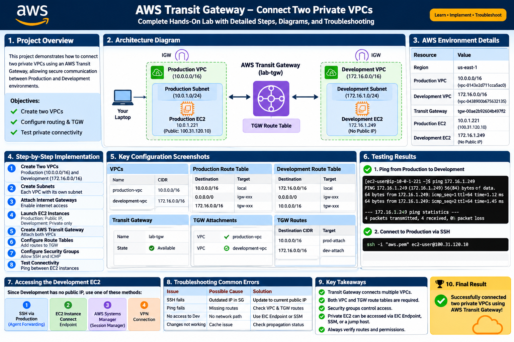
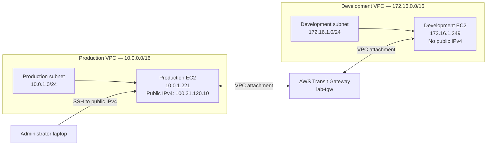
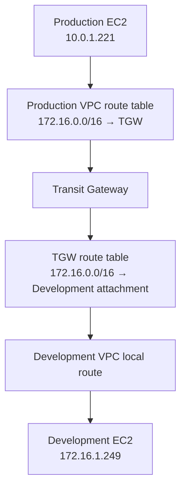
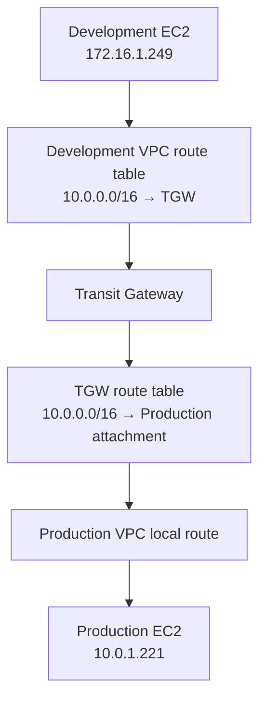

# AWS Transit Gateway – Connecting Two VPCs

**Hands-on AWS networking lab | Production and Development environments**

> This repository documents a lab that connects two separate Amazon VPCs through AWS Transit Gateway and tests private EC2-to-EC2 connectivity.

## 1. Project overview

The goal is to connect a Production VPC and a Development VPC using one AWS Transit Gateway. Each VPC contains an EC2 instance. The Production instance has a public IPv4 address for administrator SSH access; the Development instance has no public IPv4 address.

The successful test recorded in this lab was a ping from Production EC2 (`10.0.1.221`) to Development EC2 (`172.16.1.249`), with **4 packets received and 0% packet loss**.

The reverse-direction ping and EC2 Instance Connect Endpoint setup have not yet been verified.

## 2. Architecture



### Architecture at a glance



**Important:** The Transit Gateway provides private routing between the VPCs. It does not automatically connect an external laptop to either VPC. The laptop's SSH connection to Production uses the Production instance's public IPv4 address.

## 3. AWS environment

Region: **US East (N. Virginia), `us-east-1`**

### VPCs and subnets

| Setting | Production | Development |
|---|---|---|
| VPC name | `production-vpc` | `development-vpc` |
| VPC ID | `vpc-0143e2d711cca5ac0` | `vpc-0438900b675632135` |
| VPC CIDR | `10.0.0.0/16` | `172.16.0.0/16` |
| Subnet name | `production-subnet` | `development-subnet` |
| Subnet ID | `subnet-01c3b731b904d0c3c` | `subnet-08b0f76abb5382362` |
| Subnet CIDR | `10.0.1.0/24` | `172.16.1.0/24` |
| Availability Zone | `us-east-1a` | `us-east-1b` |

The CIDR ranges do not overlap. Non-overlapping CIDRs are important because the Transit Gateway must be able to make an unambiguous routing decision.

### Internet Gateways

| VPC | Internet Gateway |
|---|---|
| Production | `production-igw` — `igw-0f087cb8ccc5d56b1` |
| Development | `development-igw` — `igw-0fbc2db3588f200fd` |

An Internet Gateway is attached to each VPC. A route to an Internet Gateway alone does not make an EC2 instance publicly reachable: the instance also needs a public IP address and suitable security group rules.

### EC2 instances

| Setting | Production | Development |
|---|---|---|
| Name | `production-server` | `development-server` |
| Instance ID | `i-0090c4617354aa337` | `i-0ca7e72f7a5fa5997` |
| Private IPv4 | `10.0.1.221` | `172.16.1.249` |
| Public IPv4 | `100.31.120.10` | None |
| Instance type | `t3.micro` | `t3.micro` |
| OS | RHEL 10.2 | Linux (RHEL family; confirm exact release if documenting) |
| SSH user | `ec2-user` | `ec2-user` |
| Key pair | `aws` | `aws` |
| Security group | `production-sg` | `development-sg` |

## 4. What each AWS component does

### VPC
A Virtual Private Cloud is an isolated virtual network in AWS. The lab uses separate VPCs to represent Production and Development.

### Subnet
A subnet is an IP range inside a VPC. EC2 instances are launched into subnets. The subnets in this lab are in different Availability Zones.

### Internet Gateway
An Internet Gateway provides a path between a VPC and the internet when routes, public addressing, and security rules are configured. It is not the component used for private VPC-to-VPC traffic in this lab.

### VPC route table
A VPC route table tells resources in an associated subnet where to send traffic based on the destination IP range.

### Transit Gateway
AWS Transit Gateway is a central network hub. VPCs connect to it using VPC attachments.

### Transit Gateway route table
The Transit Gateway route table chooses the attachment to which traffic should be forwarded. This is different from the route table in each VPC.

### Route propagation
Propagation allows routes learned from an attachment to be added to a Transit Gateway route table. Propagation does not replace attachment association: association determines which TGW route table an attachment uses for traffic entering the Transit Gateway.

### Security group
A security group is a stateful virtual firewall associated with an EC2 network interface. It controls allowed inbound and outbound traffic.

## 5. Implementation steps and why each is required

### Step 1 — Create two VPCs

Create:
- `production-vpc` with CIDR `10.0.0.0/16`
- `development-vpc` with CIDR `172.16.0.0/16`

**Why:** The lab needs two separate networks. The CIDR ranges must not overlap for straightforward routing between them.

### Step 2 — Create one subnet in each VPC

Create:
- Production: `10.0.1.0/24` in `us-east-1a`
- Development: `172.16.1.0/24` in `us-east-1b`

**Why:** EC2 instances must be launched in subnets. Using different Availability Zones also demonstrates that VPC connectivity is not limited to one AZ.

### Step 3 — Attach Internet Gateways

Create and attach one Internet Gateway to each VPC.

**Why:** The Production instance needs internet-facing SSH access for this lab. The Development instance has no public IP, so it is not directly reachable from the public internet.

### Step 4 — Configure VPC route tables

The Production subnet is associated with route table `rtb-0e3d3274415ad401b`.

Production routes:

| Destination | Target | Purpose |
|---|---|---|
| `10.0.0.0/16` | `local` | Traffic within Production VPC |
| `0.0.0.0/0` | `igw-0f087cb8ccc5d56b1` | Default route to Production IGW |
| `172.16.0.0/16` | `tgw-00ae2b92604b497f2` | Traffic for Development VPC |

Development route table: `development-rt`.

Development routes:

| Destination | Target | Purpose |
|---|---|---|
| `172.16.0.0/16` | `local` | Traffic within Development VPC |
| `0.0.0.0/0` | `igw-0fbc2db3588f200fd` | Default route to Development IGW |
| `10.0.0.0/16` | `tgw-00ae2b92604b497f2` | Traffic for Production VPC |

**Why:** Each VPC needs a route for the other VPC's CIDR pointing to the Transit Gateway. The local route handles traffic inside the VPC. The default route is for destinations not matched by a more specific route.

**Note about Development subnet:** The Development EC2 has no public IP. Although the recorded Development route table has a default route to its Internet Gateway, the instance is not directly internet-reachable without public addressing and suitable rules. A more restrictive private-subnet design would normally omit the direct IGW default route and use a NAT Gateway or VPC endpoints if outbound internet access is required.

### Step 5 — Launch EC2 instances

Launch `production-server` in the Production subnet and `development-server` in the Development subnet. Use the `aws` key pair and the `ec2-user` account.

For Production, enable public IPv4 assignment. For Development, do not assign a public IPv4 address.

**Why:** These instances are the endpoints used to test private communication. The Development instance demonstrates that an EC2 instance can communicate using private IP addressing without having a public IP.

### Step 6 — Create the Transit Gateway

Create Transit Gateway `lab-tgw`, ID `tgw-00ae2b92604b497f2`.

The default association and default propagation options were enabled.

**Why:** The Transit Gateway acts as a central routing hub for the VPCs.

### Step 7 — Create VPC attachments

Create these attachments:

| VPC | Attachment name | Attachment ID |
|---|---|---|
| Production | `production-tgw-attachment` | `tgw-attach-0c9c0b57992293c7e` |
| Development | `development-tgw-attachment` | `tgw-attach-00e14322cf461f4ca` |

**Why:** A VPC must have an attachment before it can send traffic through the Transit Gateway.

Wait for the attachment state to become `Available` before testing.

### Step 8 — Verify TGW association and propagation

The TGW route table is `tgw-rtb-06dee4355f5b1a43b`.

Both attachment propagations were shown as Enabled. The TGW Routes view showed both VPC CIDRs as Active:

| Destination | Expected attachment |
|---|---|
| `10.0.0.0/16` | Production attachment |
| `172.16.0.0/16` | Development attachment |

**Why:** The Transit Gateway needs a route to identify the correct VPC attachment for each destination network.

Also verify the **Associations** tab. Each attachment must be associated with the TGW route table that should handle its incoming traffic. Propagation and association are separate settings.

## 6. How traffic travels

### Production to Development

Source: `10.0.1.221`  
Destination: `172.16.1.249`



1. Production EC2 sends a packet to `172.16.1.249`.
2. The Production subnet's route table matches `172.16.0.0/16` and sends the packet to the Transit Gateway.
3. The TGW route table matches `172.16.0.0/16` and selects the Development attachment.
4. The packet enters the Development VPC.
5. The Development VPC's local route delivers it to the Development EC2.

### Development to Production

Source: `172.16.1.249`  
Destination: `10.0.1.221`



The return direction needs its own valid route. A successful test in one direction does not, by itself, prove that every reverse-direction test has been completed.

## 7. Security group rules

Recorded inbound rules:

### `production-sg`

| Rule | Protocol/port | Source |
|---|---|---|
| SSH | TCP 22 | Administrator's current public IP `/32` |
| All ICMP - IPv4 | ICMP | `172.16.0.0/16` |

### `development-sg`

| Rule | Protocol/port | Source |
|---|---|---|
| SSH | TCP 22 | `10.0.0.0/16` |
| All ICMP - IPv4 | ICMP | `10.0.0.0/16` |

**Why ICMP?** The `ping` command uses ICMP Echo Request and Echo Reply messages. The destination security group must allow the inbound echo request. The operating system firewall must also permit it.

**Security best practice:** Restrict SSH to trusted sources. Do not use `0.0.0.0/0` for SSH unless there is a deliberate, temporary reason and compensating controls.

## 8. Connectivity tests

### SSH from laptop to Production

From Git Bash on the administrator's laptop:

```bash
ssh -i "aws.pem" ec2-user@100.31.120.10
```

The private key file must be available locally. On Linux/macOS, set restrictive permissions if required:

```bash
chmod 400 aws.pem
```

### Ping from Production to Development

After logging in to Production:

```bash
ping 172.16.1.249
```

Observed result:

```text
4 packets transmitted, 4 received, 0% packet loss
rtt min/avg/max/mdev = 1.091/1.594/3.054/0.843 ms
```

**Result:** Production-to-Development ICMP connectivity succeeded during this test.

### Reverse-direction test

From a Development terminal, run:

```bash
ping 10.0.1.221
```

Record the actual output before marking this test successful. This reverse test was not confirmed in the lab notes available when this document was prepared.

## 9. Accessing the private Development EC2

The Development EC2 has private IP `172.16.1.249` and no public IPv4 address.

This command:

```bash
ssh -i "aws.pem" ec2-user@172.16.1.249
```

works only when the SSH client has a network route to the private address. An ordinary laptop internet connection does not automatically have a route to the AWS VPC just because two VPCs are connected by a Transit Gateway.

Possible access methods:

1. **SSH jump host / agent forwarding:** Connect to Production first, then SSH to Development over the private network. Avoid copying private keys onto servers where possible.
2. **EC2 Instance Connect Endpoint:** Provides SSH connectivity to supported private instances without assigning them public IP addresses. Configure endpoint networking and security groups correctly.
3. **AWS Systems Manager Session Manager:** Provides browser or CLI shell access when the SSM Agent, IAM instance profile, and network connectivity to Systems Manager are configured.
4. **VPN:** Connect the laptop's network to AWS through a properly configured VPN.

The EC2 Instance Connect Endpoint was selected as a future lab step but has **not yet been created or tested**.

## 10. Troubleshooting and errors encountered

### Issue 1 — SSH to Production stopped working

**Observed problem:** SSH worked earlier but later failed.

**Cause identified:** The administrator's ISP public IP changed, while the Production security group still allowed the previous IP.

Previously used source IP: `106.76.175.211/32`  
Updated source IP: `106.76.161.247/32`

Check the current public IPv4 address:

```bash
curl -4 https://checkip.amazonaws.com
```

Update the Production security group's SSH source to the current IP followed by `/32`.

### Issue 2 — Development EC2 has no public IP

**Observed problem:** The laptop cannot directly SSH to the Development private IP.

**Explanation:** The laptop does not automatically have a route to `172.16.0.0/16`. The Transit Gateway connects the AWS VPCs; it does not automatically create a VPN or route from the laptop.

**Resolution options:** Use a jump host, EC2 Instance Connect Endpoint, Session Manager, or VPN.

### Issue 3 — Ping does not work

Check in this order:

1. Confirm the source instance's subnet is associated with the intended VPC route table.
2. Confirm the source VPC has a route for the destination VPC CIDR pointing to the TGW.
3. Confirm the relevant TGW attachment is `Available`.
4. Confirm the TGW route table has an active route to the destination attachment.
5. Confirm the attachment is associated with the intended TGW route table.
6. Confirm the destination VPC route table has a return route to the source CIDR via TGW.
7. Confirm the destination security group permits inbound ICMP.
8. Check the Linux host firewall and other network ACL rules.

Useful Linux commands:

```bash
ip route
ip addr
sudo systemctl status firewalld
```

Do not disable the host firewall as the first troubleshooting step. Inspect the rules and make only the required change.

### Issue 4 — TGW route is missing or inactive

Check:
- Attachment state.
- Route table association.
- Route propagation status.
- Destination CIDR.
- Whether a static route or a more specific route affects the routing decision.

## 11. Key learning: VPC route table vs TGW route table

| VPC route table | Transit Gateway route table |
|---|---|
| Used by resources in a subnet associated with that route table | Used by Transit Gateway to route traffic between attachments |
| Sends remote VPC traffic to the TGW | Selects the destination attachment |
| Example: `172.16.0.0/16 → TGW` | Example: `172.16.0.0/16 → Development attachment` |

Both are needed for this VPC-to-VPC path.

## 12. Project result and status

### Completed and observed

- [x] Created Production VPC.
- [x] Created Development VPC.
- [x] Created subnets.
- [x] Attached Internet Gateways.
- [x] Launched Production EC2.
- [x] Launched Development EC2 without a public IP.
- [x] Created Transit Gateway.
- [x] Created both VPC attachments.
- [x] Enabled propagation for both attachments.
- [x] Observed both VPC CIDR routes as Active in the TGW route table.
- [x] Configured VPC route table routes.
- [x] Configured security group rules.
- [x] Connected to Production EC2 over SSH.
- [x] Successfully pinged Development EC2 from Production.

### Pending / not yet verified

- [ ] Verify reverse-direction ping from Development to Production.
- [ ] Create an EC2 Instance Connect Endpoint.
- [ ] Test browser-based SSH to Development.
- [ ] Capture final AWS Console screenshots.

## 13. Suggested repository screenshots

Save actual AWS Console screenshots in the `images/` directory:

| Filename | Screenshot to capture |
|---|---|
| `01-vpc-list.png` | Both VPCs and CIDRs |
| `02-subnets.png` | Production and Development subnets |
| `03-internet-gateways.png` | Internet Gateway attachments |
| `04-ec2-instances.png` | Both EC2 instances and IP addresses |
| `05-production-route-table.png` | Production route table |
| `06-development-route-table.png` | Development route table |
| `07-transit-gateway.png` | Transit Gateway details |
| `08-tgw-attachments.png` | Both VPC attachments |
| `09-tgw-propagations.png` | Propagation settings |
| `10-tgw-routes.png` | Active TGW routes |
| `11-security-groups.png` | Inbound rules |
| `12-production-ssh.png` | SSH session to Production |
| `13-ping-test.png` | Successful ping output |

To embed a screenshot in this README:

```markdown

```

## 14. Repository structure

```text
aws-transit-gateway-vpc-connectivity/
├── README.md
└── images/
    ├── architecture-infographic.png
    ├── 01-vpc-list.png
    ├── 02-subnets.png
    ├── 03-internet-gateways.png
    ├── 04-ec2-instances.png
    ├── 05-production-route-table.png
    ├── 06-development-route-table.png
    ├── 07-transit-gateway.png
    ├── 08-tgw-attachments.png
    ├── 09-tgw-propagations.png
    ├── 10-tgw-routes.png
    ├── 11-security-groups.png
    ├── 12-production-ssh.png
    └── 13-ping-test.png
```

## 15. Cost and cleanup considerations

AWS resources may incur charges while running. Review the current AWS pricing for the selected Region and resource types before leaving the lab running.

When finished, review dependencies and clean up resources that are no longer required. A typical cleanup includes:
1. Terminate lab EC2 instances.
2. Delete the VPC attachments.
3. Delete the Transit Gateway after all attachments are removed.
4. Detach and delete Internet Gateways.
5. Delete unused subnets and route tables.
6. Delete the VPCs.
7. Check for EBS volumes, snapshots, Elastic IPs, and other billable resources.

Do not delete resources until you are sure they are not used by another workload.

## 16. Conclusion

This hands-on project demonstrates private communication between two AWS VPCs using Transit Gateway.

The key concept learned is that the source VPC route table forwards traffic to the Transit Gateway, and the Transit Gateway route table selects the destination VPC attachment. The destination VPC then delivers the packet using its local route.

The Production-to-Development ping test succeeded with zero packet loss. Further testing is planned to verify reverse connectivity and private-instance access using an EC2 Instance Connect Endpoint.
